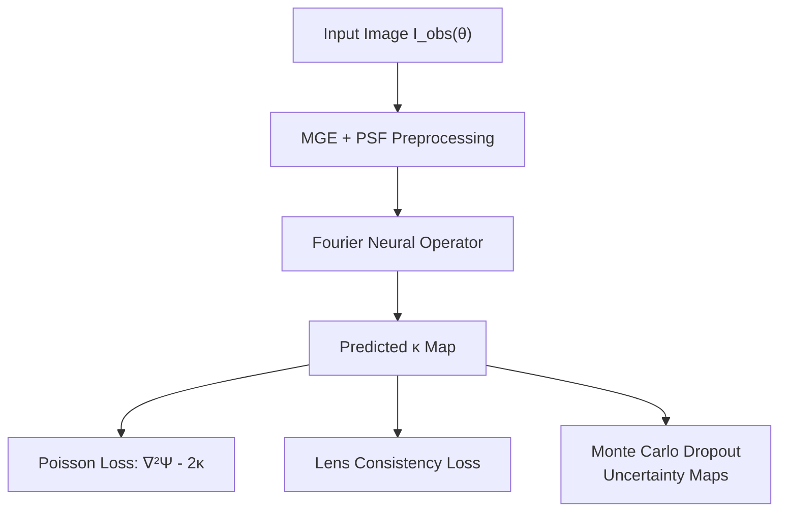
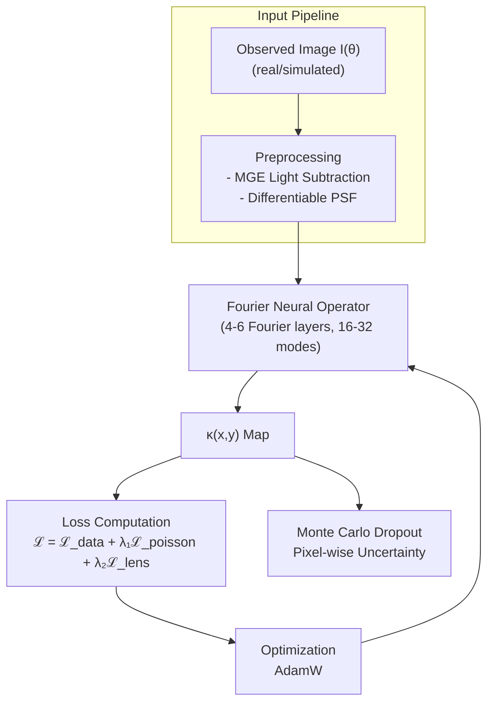
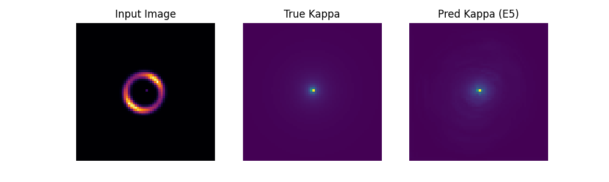
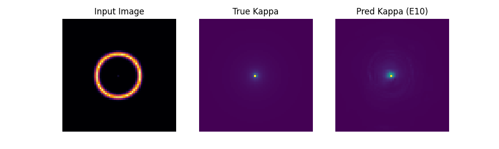
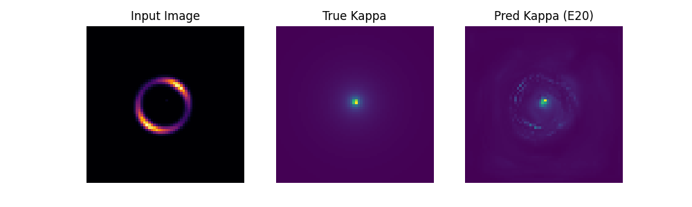

# FNO: Fourier Neural Operator for κ-Map Reconstruction
### Learning dark matter mass distributions directly from lensing images

---

## Introduction

### FNO

This proposal introduces a Fourier Neural Operator (FNO) approach for direct κ-map reconstruction. Unlike DI-PINN which embeds a differentiable simulator as a fixed layer, FNO learns the mapping from images to mass maps directly, with physics enforced through soft constraints in the loss function. This offers a simpler, lower-risk path to the same scientific goal.

Fourier Neural Operators are designed to learn mappings between function spaces. Instead of operating on fixed grids like CNNs, they perform global convolutions in the Fourier domain, capturing long-range dependencies naturally. This makes them particularly well-suited for lensing, where every point in the image is influenced by the entire mass distribution.

**Core Architecture Components:**

- **FNO Backbone:** A stack of Fourier layers that takes the observed lensed image as input and outputs the convergence field κ(x,y). Each Fourier layer performs a Fast Fourier Transform, multiplies the low-frequency modes by learnable weights, and transforms back—enabling efficient global reasoning.

- **Physics-Informed Losses:** Rather than hard-coding the physics, we enforce it through loss terms. The Poisson equation ∇²Ψ = 2κ and lens equation consistency are added as soft constraints during training, guiding the network toward physically plausible solutions.

- **Differentiable PSF Module:** A fixed convolutional layer with the telescope's PSF kernel ensures the model learns to account for instrumental blurring.

- **MGE Pre-processing:** Multi-Gaussian Expansion removes foreground lens light before training, isolating the faint arcs that contain substructure information.

- **Monte Carlo Dropout:** Provides pixel-wise uncertainty estimates without the computational cost of full ensembles.

#### Core Architecture Flow

The architecture learns the mapping I(θ) → κ(x,y) directly, with physics guiding the learning through loss terms rather than hard-coded layers.

1. **Preprocessing:** MGE removes lens light; differentiable PSF convolution accounts for telescope blur.
2. **FNO Forward Pass:** The network transforms the image through successive Fourier layers, outputting a full-resolution κ map.
3. **Physics Constraints:** The predicted κ is used to compute Poisson and lens equation residuals, which are added to the loss.
4. **Uncertainty:** Monte Carlo dropout during inference provides pixel-wise variance estimates.

## Architecture Data Flow

The architecture is designed for simplicity and stability while still delivering scientifically useful mass maps.

## Prototype

The prototype follows the direct κ-map reconstruction approach and data pipeline. To establish our training loop and baseline performance, this prototype currently utilizes a U-Net architecture as a stand-in for the complete FNO backbone.

**Progress to Date:**
- **Data Generation:** Developed a synthetic lensing dataset generator yielding pairs of lensed images and their corresponding Singular Isothermal Sphere (SIS) mass profiles.
- **Model Definition:** Created a compact U-Net model mapping 64x64 input lensed images directly to underlying convergence fields ($\kappa$).
- **Model Training:** Successfully trained the prototype supervised on 1,000 simulated samples for 20 epochs using Mean Squared Error (MSE) loss.

**Preliminary Results:**
The network quickly learns to localize the main deflector's mass and estimate the basic structure of the convergence field. Below are network predictions at different epochs, illustrating the input lensed image, the ground-truth $\kappa$ map, and the network's corresponding prediction. The convergence gets noticeably better throughout training.

**Epoch 5 Prediction:**

**Epoch 10 Prediction:**

**Epoch 20 Prediction:**

## Key Components

This approach prioritizes simplicity and lower risk while still achieving the core goal: κ-map reconstruction.

| Component / Feature | LensPINN (2024) | FNO (This Architecture) | Why it's critical here |
| --- | --- | --- | --- |
| **Physics Enforcement** | Hard-coded lens equation (scalar Einstein radius). | Soft constraints via loss terms (Poisson, lens equation). | Simpler implementation; no external physics library required. Gradients flow easily. |
| **Architecture Type** | Hybrid ViT + CNN with inverse layer. | Pure Fourier Neural Operator. | Global receptive field captures lensing's non-local nature naturally. Resolution independent. |
| **Input Data** | Simulated Model II only. | Designed for real HSC/HST/LSST data with MGE pre-processing. | Same real-data handling as DI-PINN, but with simpler adaptation path. |
| **Foreground Light** | Assumed removed. | MGE subtraction as pre-processing. | Standard astronomy tool; runs once per image outside training loop. |
| **Scientific Output** | Class label. | κ map + uncertainty. | Direct mass reconstruction enables subhalo localization and mass estimation. |
| **Uncertainty** | Deterministic. | Monte Carlo dropout. | Lightweight uncertainty without training multiple models. |
| **Resolution Independence** | Fixed to training resolution. | FNO can be applied to any resolution without retraining. | Critical for applying to diverse surveys (HSC 64×64, HST up to 150×150). |
| **Domain Adaptation** | None. | Fine-tuning with physics losses on real data. | Simpler than PI-AdaMatch; can be combined with CycleGAN if needed. |

## The Physics

The network is guided by the same physical equations as DI-PINN, but they are enforced through loss terms rather than hard-coded layers. This makes implementation simpler while still ensuring scientific validity.

## Anticipated Challenges and Mitigation Strategies

Applying neural operators to real lensing data introduces several challenges. The pipeline includes the following mitigations:

| Roadblock | Mitigation Strategy |
| --- | --- |
| **FNO training can be unstable.** | Use established `neuralop` library implementation. Start with small model (4 layers, 16 modes) and gradually increase capacity. Learning rate scheduling and gradient clipping. |
| **Physics loss weighting is tricky.** | Begin with supervised pre-training on simulations. Gradually introduce physics losses. Use adaptive loss balancing if needed. |
| **Ray-tracing for lens loss is expensive.** | Use simplified ray-tracer or pre-computed mappings for efficiency. Can also use a small learned surrogate for the lens equation. |
| **Real-data domain shift.** | Fine-tune on real images with physics-only losses. If needed, add CycleGAN or simple adversarial domain adaptation. |
| **Uncertainty calibration.** | Validate on simulations with ground truth. Use temperature scaling to calibrate dropout uncertainties. |
| **MGE isn't differentiable.** | Run as pre-processing once per image. Lens light isn't part of dark matter inference, so this is sufficient. |
| **No ground truth κ for real data.** | Compare with Lenstronomy MCMC fits on well-studied lenses. Injection-recovery tests on real images with synthetic subhalos. |

## Comparison with DI-PINN

| Aspect | DI-PINN | FNO (This Proposal) |
| --- | --- | --- |
| **Physics Embedding** | Hard-coded differentiable simulator (`caustics`). | Soft constraints via loss terms. |
| **Implementation Complexity** | High (requires integrating external library, MGE, PI-AdaMatch, ensembles). | Moderate (FNO + physics losses + MGE + dropout). |
| **Risk Level** | Medium (integration challenges). | Low (well-understood components). |
| **Novelty** | High – first differentiable-physics PINN for lensing. | Medium – FNOs are known, but new to lensing κ reconstruction. |
| **Output** | κ map + source + uncertainty. | κ map + uncertainty. |
| **Uncertainty Method** | Deep Ensembles (5-10 models). | Monte Carlo dropout (single model). |
| **Training Time** | Higher (ensembles). | Moderate. |
| **Resolution Independence** | Via `caustics`, but network may be resolution-dependent. | FNO is inherently resolution independent. |

